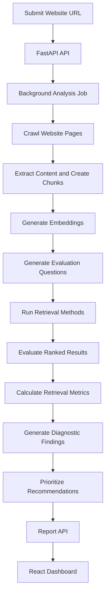

<div align="center">

# AI Search Visibility Intelligence Platform

### Analyze website content. Evaluate retrieval quality. Turn evidence into action.

An AI-search visibility research MVP that crawls websites, compares retrieval strategies, evaluates search quality, and generates evidence-backed diagnostics and prioritized recommendations.


</div>

---

## Overview

**AI Search Visibility Intelligence Platform** investigates how effectively information from a website can be retrieved by different search approaches.

Submit a website URL and the platform runs an analysis pipeline: it crawls eligible pages, extracts and chunks content, creates embeddings, evaluates retrieval methods against evaluation questions and relevance labels, and generates a report with retrieval metrics, diagnostic findings, and practical recommendations.

The goal is to make retrieval behavior measurable and explainable rather than hiding it behind a single opaque score.

> **Important:** This MVP evaluates a controlled retrieval simulation over crawled website content. It does not directly measure whether ChatGPT, Gemini, or other external AI products crawl, retrieve, cite, or recommend a website.

## Why this project?

Improving AI-search discoverability requires more than guessing which content might perform well. This project brings several steps into one workflow:

- **Inspect:** Crawl website pages and extract available content and structure.
- **Retrieve:** Compare semantic, lexical, hybrid, and reranked results.
- **Evaluate:** Measure retrieval quality using information-retrieval metrics.
- **Diagnose:** Connect findings to observable results and supporting evidence.
- **Recommend:** Generate prioritized actions and ways to verify improvements.

## Key features

- Website crawling and content extraction
- Text chunking and vector embeddings
- AI-assisted evaluation-question generation
- Semantic retrieval using embeddings
- Lexical text-based retrieval
- Hybrid retrieval using Reciprocal Rank Fusion (RRF)
- Hybrid retrieval with a reranking stage
- Precision@K, Recall@K, MRR, and NDCG@K evaluation
- Diagnostic findings with severity and evidence
- Prioritized recommendations with suggested actions and verification steps
- React and TypeScript dashboard
- Retrieval-metric visualizations
- FastAPI backend with Redis and RQ background processing
- PostgreSQL storage with pgvector

## How it works



## Retrieval methods

| Method | Purpose |
|---|---|
| **Semantic** | Finds content using embedding-based similarity. |
| **Lexical** | Retrieves content through text-based matching. |
| **Hybrid** | Combines retrieval signals using Reciprocal Rank Fusion. |
| **Hybrid + reranker** | Reorders hybrid candidates using a reranking stage. |

These methods are evaluated against the same evaluation questions to make their observed behavior easier to compare.

## Evaluation metrics

| Metric | Meaning |
|---|---|
| **Precision@K** | Proportion of the top-K retrieved chunks that are relevant. |
| **Recall@K** | Proportion of known relevant chunks retrieved within the top K. |
| **MRR** | How highly the first relevant result appears in the ranking. |
| **NDCG@K** | How effectively relevant results are ordered within the top K. |

Evaluation quality depends on the questions, crawled content, candidate results, and relevance labels. AI-generated questions can help create an evaluation dataset, but relevance labels should be reviewed rather than blindly trusted.

## Diagnostics and recommendations

The platform separates three stages:

1. **Evaluation:** Measures how retrieval methods rank relevant content.
2. **Diagnostics:** Identifies observable patterns, such as empty results, ranking problems, or missing extracted headings.
3. **Recommendations:** Turns findings into prioritized actions and verification steps.

A retrieval problem does not automatically prove that a website has a content problem. For example, missing extracted headings could mean the page lacks headings or that the extraction logic needs investigation. Findings should be checked against their evidence before action is taken.

## Technology stack

### Frontend
- React
- TypeScript
- Vite
- Tailwind CSS
- Recharts
- Lucide React

### Backend
- Python
- FastAPI
- SQLAlchemy
- PostgreSQL
- pgvector
- Redis
- RQ
- Gemini API for AI-assisted tasks

## Project structure

```text
ai-search-visibility/
├── backend/
│   ├── app/
│   │   ├── api/
│   │   ├── core/
│   │   ├── db/
│   │   ├── models/
│   │   ├── schemas/
│   │   ├── services/
│   │   ├── workers/
│   │   ├── main.py
│   │   ├── queue.py
│   │   └── tasks.py
│   ├── tests/
│   ├── .env.example
│   └── requirements.txt
├── frontend/
│   ├── public/
│   ├── src/
│   ├── package.json
│   └── vite.config.ts
├── .gitignore
└── README.md
```

## Getting started

### Prerequisites

- Python 3.10+
- Node.js and npm
- PostgreSQL with pgvector
- Redis
- A Gemini API key for AI-assisted features

### 1. Clone the repository

```bash
git clone https://github.com/YOUR_GITHUB_USERNAME/ai-search-visibility.git
cd ai-search-visibility
```

Replace `YOUR_GITHUB_USERNAME` with your GitHub username.

### 2. Configure the backend

```bash
cd backend
python3 -m venv .venv
source .venv/bin/activate
pip install -r requirements.txt
cp .env.example .env
```

Configure the database connection, Redis settings, and Gemini API key in your local `backend/.env`, using the variables required by the application.

Ensure PostgreSQL and Redis are running, create the configured database, and enable pgvector in that database:

```sql
CREATE EXTENSION IF NOT EXISTS vector;
```

Never commit your `.env` file or place real credentials in `.env.example`.

### 3. Start the API

From the `backend/` directory, with the virtual environment activated:

```bash
uvicorn app.main:app --reload
```

Interactive API documentation:

http://127.0.0.1:8000/docs

### 4. Start the background worker

Open a second terminal:

```bash
cd backend
source .venv/bin/activate
rq worker --worker-class rq.worker.SimpleWorker analysis
```

The worker must be running to process queued analyses. `SimpleWorker` is the worker mode used during local development on macOS.

### 5. Start the frontend

Open a third terminal from the project root:

```bash
cd frontend
npm install
npm run dev
```

Open the local URL printed by Vite. The development server proxies `/analyses` requests to the local FastAPI backend.

## API endpoints

| Method | Endpoint | Purpose |
|---|---|---|
| `POST` | `/analyses/` | Submit a website for analysis. |
| `GET` | `/analyses/{analysis_id}` | Check analysis status. |
| `GET` | `/analyses/{analysis_id}/report` | Retrieve the completed report. |

## Testing

Backend tests are located in `backend/tests/`.

From the backend directory, activate the virtual environment and run:

```bash
pytest
```

To check the frontend production build:

```bash
cd frontend
npm run build
```

Successful tests and builds are useful checks, but they do not by themselves guarantee production readiness.

## Security and responsible interpretation

- Keep API keys, passwords, and `.env` files out of version control.
- Respect target websites' access policies and crawling restrictions.
- Treat generated findings as hypotheses supported by evidence, not unquestionable conclusions.
- Review relevance labels before drawing conclusions from evaluation metrics.
- Do not interpret simulated retrieval metrics as direct visibility or citation measurements from external AI systems.

## Current status

**MVP milestone: Core workflow implemented.**

The project includes website crawling, retrieval-method evaluation, diagnostic findings, prioritized recommendations, and frontend report integration.

### Potential next steps

- Validate results across more real-world websites.
- Expand and independently review evaluation datasets.
- Improve observability and automated test coverage.
- Deploy the application.
- Add authentication and account management.
- Continue production security, reliability, and resource-limit improvements.
- Explore external AI-search citation monitoring as a separate capability.

## License

No license has been added yet. Until a license is included, standard copyright applies and reuse is not automatically granted.

---

<div align="center">

**Built to explore retrieval evaluation, explainable diagnostics, and AI-search discoverability.**

</div>